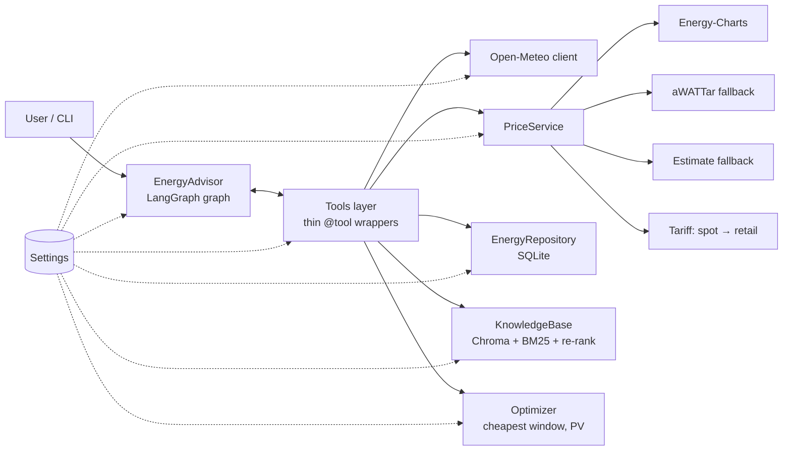

# Portfolio Refactoring Plan: Solar & EV Energy Optimizer Agent

This document is the plan for turning the current notebook-based course project into a production-style
portfolio repository. It has three parts:

- **Analysis:** what the code does today, what is worth keeping, and what has to change.
- **Plan:** the target architecture, the two functional changes (relocation to Munich and real electricity
  prices), and the work split into phases you can review one at a time.
- **Suggestions:** improvements beyond the brief that make the project stronger as a portfolio piece.

Advanced terms are explained briefly where they first appear. The [Glossary](#14-glossary) at the end
collects them in one place.

---

## 1. Summary

| Topic | Today | Target |
|---|---|---|
| Code layout | 4 Jupyter notebooks plus `agent.py`, `tools.py` and `models/` at the repo root | Installable Python package in a `src/` layout, with a command-line interface (CLI) replacing the notebooks |
| Configuration | `os.getenv(...)` scattered over 4 places; hard-coded paths, model names and prices | One typed `Settings` class (pydantic-settings), loaded from environment variables or `.env` |
| Location | San Francisco, USD, °F tips, US-style time-of-use tariff | Munich (48.137 N, 11.575 E), `Europe/Berlin` time zone, EUR, metric units |
| Electricity prices | Mock tariff (0.12 USD/kWh × fixed multipliers) | Real German day-ahead prices (Energy-Charts API, with aWATTar as fallback), converted to a household retail price |
| Weather | Live Open-Meteo forecast, with a simulated fallback (good, keep it) | Same, using fixed coordinates from `Settings` (no ambiguous geocoding) |
| Sample data | Random, unseeded, US-shaped (air conditioning at noon, flat 0.10 to 0.15 USD/kWh) | Seeded and reproducible; driven by real Munich weather and real historical prices |
| Tests | 30 pytest tests, some depending on generated data and on notebook outputs | Unit, contract and integration tests with no dependency on notebooks; HTTP and LLM calls replaced by fakes |
| Quality tooling | None | ruff (lint and format), optional mypy, pre-commit, GitHub Actions CI |
| Evaluation | Notebook 03 (LLM-as-judge, 13 cases) | `energy-advisor eval` command; test cases in YAML; Markdown report and PNG heatmap written to `reports/` |

**Key recommendation beyond the brief:** add a deterministic optimization tool, `find_cheapest_window`. The
LLM should not do the arithmetic for "when should I charge?". The latest evaluation shows that accuracy is
the weakest metric (0.76 to 0.84), mostly because of wrong hours. A tool that computes the optimal window from
real prices and the solar forecast fixes that, and it makes the "data-driven decisions" requirement
literally true. Details are in [section 9](#9-suggestions-beyond-the-brief).

---

## 2. Analysis of the current code

### 2.1 What is good and should be kept

- **Agent graph** (`agent.py`): a clean, explicit LangGraph `StateGraph` with `agent ↔ ToolNode` routing,
  `handle_tool_errors=True`, a recursion limit and a fallback answer when the graph fails. Calendar
  injection for resolving "tomorrow" or "Wednesday" is a nice touch.
- **Advanced RAG** (`tools.py`): hybrid retrieval (vector search plus BM25, fused with Reciprocal Rank
  Fusion), then LLM re-ranking with a graceful fallback. The retrieval benchmark from notebook 02 (hit@3
  and MRR on 12 labelled queries) belongs in the README.
- **Context-friendly tool outputs:** tools return aggregates instead of thousands of raw rows (regression
  F-04).
- **Live weather** from Open-Meteo, with a deterministic simulated fallback.
- **Regression tests with IDs (F-01 to F-11):** a good engineering habit worth highlighting.
- **Evaluation pipeline:** LLM-as-judge, deterministic tool-usage metrics and an aggregated report.
- **Knowledge base:** 8 documents of about 2,300 words in total.

### 2.2 Problems found

| # | Problem | Where | Why it matters | Fix |
|---|---|---|---|---|
| 1 | **Import-time side effects:** `load_dotenv()` and `db_manager = DatabaseManager()` run when the module is imported | `tools.py:25-28`, `agent.py:10` | Importing the module opens a database and reads files. Tests cannot inject a temporary database, and the import fails in CI without data | Dependency injection: build services from `Settings` inside a factory function |
| 2 | **Paths relative to the current working directory** (`"data/energy_data.db"`) | `tools.py:30-31`, `models/energy.py:42`, `conftest.py:18` (`os.chdir`) | Code works only when started from the repo root | Resolve paths from `Settings`, with defaults anchored to the project root |
| 3 | **Naive datetimes** (`datetime.now()` without a time zone) | everywhere | "Now" is the clock of the machine, but the forecast is in the location's time zone. Wrong "today/tomorrow" near midnight. Daylight-saving days have 23 or 25 hours | Time-zone-aware datetimes with `zoneinfo.ZoneInfo(settings.location.timezone)`. Enforce with ruff rule `DTZ` |
| 4 | **Configuration duplicated** (API key, base URL, model name) | `agent.py:21-22`, `tools.py:41-42`, `tools.py:608-609`, notebook 03 | Four places to change; the course proxy URL (`openai.vocareum.com`) is the default | A single `Settings` class. Default to the standard OpenAI endpoint; `base_url` becomes optional |
| 5 | **Deprecated SQLAlchemy API** (`sqlalchemy.ext.declarative.declarative_base`, `session.query`) | `models/energy.py` | Emits deprecation warnings in SQLAlchemy 2.x and looks dated to reviewers | SQLAlchemy 2.0 style: `DeclarativeBase`, `Mapped[...]`, `mapped_column`, `select()` |
| 6 | **One commit per inserted row** (`add_usage_record` opens a session and commits each row) | `models/energy.py:70-105`, notebook 01 | 2,160 transactions for 30 days of data, which is slow | Bulk insert in one transaction (`session.add_all` or `insert().values(...)`) |
| 7 | **Unseeded random sample data** anchored at `datetime.now()` | notebook 01 | Not reproducible, and the README ("ends yesterday") does not match the code (starts `now - 30 days`) | Seeded generator with an explicit end date (yesterday in Europe/Berlin) |
| 8 | **Untyped tool outputs** (`Dict[str, Any]` built by hand) | all tools | No schema, easy to break the contract silently | Pydantic models for tool outputs; `.model_dump()` before returning to the LLM |
| 9 | **Broad `except Exception` without logging** | most tools | Errors are swallowed; you cannot see why something failed | Keep the "return a structured error to the LLM" contract, but log the exception (`logger.exception`) and catch narrower exception types where possible |
| 10 | **Global mutable cache** (`_RAG_CACHE` dict) plus a manual `reset_rag_cache()` | `tools.py:499-508` | Hidden state; notebook 02 needed a workaround for a Windows file lock | A `KnowledgeBase` class that owns its vector store and BM25 index. Rebuilding runs as a separate CLI process, so the file lock problem disappears |
| 11 | **Tests depend on notebook files and on generated data** | `test_regression.py:303-332`, fixtures `energy_db` / `vector_db` | They break once the notebooks are removed, and most tests are skipped in a clean checkout or CI | Fixtures that build a small temporary database (`tmp_path`). Notebook tests become tests of the `evaluation` module |
| 12 | **Currency and units are US-specific**: column `cost_usd`, `price_per_kwh=0.12`, CO₂ factor 0.4 kg/kWh, `°F` in knowledge-base documents | DB model, tools, KB (15 US-specific mentions in 7 files) | Wrong for Munich | Columns `cost_eur`; currency, VAT and CO₂ factor in `Settings`; localize the KB (section 4.5) |
| 13 | **No packaging or tooling**: `pyproject.toml` has an empty dependency list; there is no lint config and no CI | repo root | A reviewer cannot install and run the project with one command | Section 7 |
| 14 | **`print()` used for status output** | `models/energy.py:50`, notebooks | Not configurable, mixes data and logging | `logging` (and `rich` for nice CLI output) |

---

## 3. Target architecture

### 3.1 Repository layout

The **src layout** puts the package under `src/`, so tests always run against the *installed* package and
not by accident against files in the current directory. It is the layout recommended by the Python
Packaging Authority.

```
solar-ev-energy-optimizer-agent-langgraph/
├── src/energy_advisor/
│   ├── __init__.py
│   ├── config.py               # Settings (pydantic-settings): the single source of configuration
│   ├── logging_config.py
│   ├── cli.py                  # Typer CLI: seed-db, build-index, ask, eval, report
│   ├── domain/
│   │   ├── schemas.py          # Pydantic models: PriceSlot, PriceCurve, WeatherForecast, SavingsResult, ...
│   │   └── time.py             # tz-aware helpers: now(), today(), day_bounds(), DST-safe hour ranges
│   ├── data/
│   │   ├── db.py               # SQLAlchemy 2.0 engine/session factory
│   │   ├── models.py           # ORM tables: EnergyUsage, SolarGeneration
│   │   ├── repository.py       # EnergyRepository: queries + aggregation (was in tools.py)
│   │   └── seed.py             # reproducible Munich sample-data generator (was notebook 01)
│   ├── clients/
│   │   ├── http.py             # shared httpx client: timeouts, retries, User-Agent
│   │   ├── open_meteo.py       # forecast + past weather
│   │   └── prices/
│   │       ├── base.py         # PriceProvider protocol
│   │       ├── energy_charts.py
│   │       ├── awattar.py
│   │       ├── estimate.py     # fallback when tomorrow's auction is not published yet
│   │       └── tariff.py       # wholesale → retail conversion (grid fees, taxes, VAT)
│   ├── rag/
│   │   ├── ingest.py           # load + split + embed (was notebook 02)
│   │   ├── retrieval.py        # vector, BM25, RRF fusion
│   │   ├── rerank.py           # LLM re-ranking
│   │   └── knowledge_base.py   # KnowledgeBase class (replaces the global _RAG_CACHE)
│   ├── optimization/
│   │   ├── scheduling.py       # find_cheapest_window (deterministic)
│   │   └── pv.py               # PV yield estimate from irradiance
│   ├── agent/
│   │   ├── prompts.py          # SYSTEM_PROMPT (was a string in notebook 03)
│   │   ├── tools.py            # thin LangChain @tool wrappers → services
│   │   └── graph.py            # build_graph(), EnergyAdvisor class
│   ├── evaluation/
│   │   ├── cases.yaml          # the 13 test questions + expected tools/answers
│   │   ├── judge.py            # LLM-as-judge
│   │   ├── metrics.py          # tool usage metrics (deterministic)
│   │   └── report.py           # Markdown/JSON report + heatmap PNG
│   └── viz/
│       └── charts.py           # charts from notebook 04 → PNG files
├── knowledge_base/             # the .txt documents (localized for Germany)
├── tests/
│   ├── conftest.py
│   ├── fixtures/               # recorded API responses (JSON) for offline tests
│   ├── unit/
│   ├── integration/
│   └── e2e/
├── reports/                    # generated evaluation reports and charts (only curated ones committed)
├── docs/                       # architecture notes, images for the README
├── .github/workflows/ci.yml
├── .env.example
├── .pre-commit-config.yaml
├── pyproject.toml
├── uv.lock
├── LICENSE
└── README.md
```

### 3.2 Layers and data flow

The main rule is the **dependency direction**: the agent layer depends on services, services depend on
clients and the repository, and nothing depends on the agent. Business logic (price conversion,
aggregation, scheduling) therefore never imports LangChain and can be unit-tested without an LLM.



### 3.3 Tools with dependency injection

LangChain `@tool` functions are usually module-level functions, which leads to the global
`db_manager` we have now. Instead, a factory builds the tools around injected services:

```python
def build_tools(services: Services) -> list[BaseTool]:
    @tool
    def get_electricity_prices(date: str | None = None) -> dict:
        """Hourly household electricity prices in EUR/kWh for Munich (day-ahead market + tariff)."""
        return services.prices.get_curve(parse_date(date)).model_dump(mode="json")

    ...
    return [get_weather_forecast, get_electricity_prices, ...]
```

In tests, `Services` is built with a temporary database and fake HTTP clients, so no monkey-patching of
module globals is needed.

> **Dependency injection (DI):** a component receives the objects it needs (database, HTTP client, settings)
> from outside instead of creating them itself. This makes swapping real objects for fakes in tests trivial.

---

## 4. Configuration: the `Settings` class

### 4.1 Why a `Settings` class at all

1. **Single source of truth.** The API key, base URL, model name, location, paths and tariff
   parameters live in one place instead of being spread over four files.
2. **Validation at startup ("fail fast").** If `OPENAI_API_KEY` is missing or `VAT_RATE=abc`, the program
   stops immediately with a clear message, not halfway through an agent run.
3. **Typed values.** `settings.tariff.vat_rate` is a `float` and `settings.paths.db` is a `Path`, so your
   IDE and mypy can check usage.
4. **Secrets are masked.** `SecretStr` prints as `**********` in logs and reprs.
5. **12-factor configuration.** The same code runs locally (`.env`), in CI (environment variables) and in
   Docker without changes. Changing the city to Frankfurt means changing one variable, not the code.

> **12-factor app:** a widely used set of principles for deployable software. Factor III says that
> configuration that varies between environments belongs in environment variables, not in code.

### 4.2 Sketch

```python
# src/energy_advisor/config.py
from functools import lru_cache
from pathlib import Path

from pydantic import AliasChoices, BaseModel, Field, SecretStr
from pydantic_settings import BaseSettings, SettingsConfigDict

PROJECT_ROOT = Path(__file__).resolve().parents[2]


class LocationSettings(BaseModel):
    name: str = "Munich, Germany"
    latitude: float = 48.1374
    longitude: float = 11.5755
    timezone: str = "Europe/Berlin"
    bidding_zone: str = "DE-LU"  # electricity market area (see glossary)


class TariffSettings(BaseModel):
    """Converts the wholesale day-ahead price into what a household actually pays."""

    currency: str = "EUR"
    surcharges_eur_per_kwh: float = 0.19  # net grid fees + levies + electricity tax + supplier margin
    vat_rate: float = 0.19
    feed_in_tariff_eur_per_kwh: float = 0.08  # paid for exported solar (check current EEG rate)
    fixed_price_eur_per_kwh: float = 0.35  # used only by the "fixed tariff" comparison/fallback


class HomeSettings(BaseModel):
    pv_peak_kw: float = 8.0  # installed PV size (kWp)
    pv_performance_ratio: float = 0.8
    wallbox_kw: float = 11.0
    co2_kg_per_kwh: float = 0.36  # German grid mix, approx. (UBA); keep configurable


class LLMSettings(BaseModel):
    model: str = "gpt-4o-mini"
    embedding_model: str = "text-embedding-3-small"
    temperature: float = 0.0


class PathSettings(BaseModel):
    db: Path = PROJECT_ROOT / "data" / "energy_data.db"
    vectorstore: Path = PROJECT_ROOT / "data" / "vectorstore"
    knowledge_base: Path = PROJECT_ROOT / "knowledge_base"
    reports: Path = PROJECT_ROOT / "reports"


class Settings(BaseSettings):
    model_config = SettingsConfigDict(env_file=".env", env_nested_delimiter="__", extra="ignore")

    openai_api_key: SecretStr = Field(validation_alias=AliasChoices("OPENAI_API_KEY"))
    openai_base_url: str | None = None  # only for proxies/compatible endpoints

    location: LocationSettings = LocationSettings()
    tariff: TariffSettings = TariffSettings()
    home: HomeSettings = HomeSettings()
    llm: LLMSettings = LLMSettings()
    paths: PathSettings = PathSettings()


@lru_cache
def get_settings() -> Settings:
    return Settings()
```

Overriding a nested value from the environment uses the `__` delimiter:

```dotenv
# .env.example  (committed; the real .env is git-ignored)
OPENAI_API_KEY=
# OPENAI_BASE_URL=            # optional, only for OpenAI-compatible proxies
# LOCATION__NAME="Frankfurt am Main, Germany"
# LOCATION__LATITUDE=50.1109
# LOCATION__LONGITUDE=8.6821
# TARIFF__SURCHARGES_EUR_PER_KWH=0.19
# HOME__PV_PEAK_KW=10
```

**Design notes**

- The `openai_api_key` field is required. Unit tests construct `Settings(openai_api_key="test")`
  directly, so they never need a real key.
- `get_settings()` is cached, so the `.env` file is read once. Tests should **not** use the cached
  instance; they pass their own `Settings` object to the factories.
- Default values are the documented Munich demo setup. Everything is overridable without code changes.

---

## 5. Relocation: San Francisco → Munich

### 5.1 Location and time

- **Fixed coordinates** in `Settings`, so geocoding is not needed for the default location. This
  removes the "Frankfurt am Main vs. Frankfurt (Oder)" ambiguity of the current `_geocode`, which uses the
  first search hit for the text before the first comma. Keep geocoding as an option for other cities,
  but return a `resolved_location` and warn when the match is ambiguous (several hits with similar
  population).
- **Time-zone-aware time everywhere** (`domain/time.py`):
  - `now()` returns `datetime.now(ZoneInfo(settings.location.timezone))`.
  - The calendar injected into the prompt uses the Munich date, not the machine date.
  - Database timestamps are stored in **UTC** and converted to `Europe/Berlin` for display and
    aggregation by hour of day.
  - Tests cover the daylight-saving days: the last Sunday of March has 23 hours and the last Sunday of
    October has 25 hours. A daily price curve must handle both.
- **Units:** °C (already used by Open-Meteo), kWh, EUR, and a 24-hour clock in answers. Set this in the
  system prompt.

### 5.2 Weather

Open-Meteo stays: it is free, needs no key and covers Germany well (DWD ICON models). Changes:

- Query by latitude and longitude from `Settings` and pass `timezone=Europe/Berlin` explicitly instead of
  `auto`.
- Add `direct_radiation` and `diffuse_radiation` (useful for a better PV estimate) and `sunshine_duration`.
- The simulated fallback stays, but uses Munich climate ranges (for example, October means of about
  5 to 15 °C instead of 12 to 22 °C) and day length by date (Munich has about 8 h of daylight in December
  and about 16 h in June). The current fixed 06:00 to 18:00 window is wrong for Munich in most months.

### 5.3 Realistic sample data for a Munich household

The current generator creates air conditioning at noon, which is typical for California. In Munich the
large electrical loads are **heating** (heat pump), the **EV** and appliances. Proposal for `data/seed.py`:

| Series | Model | Source of realism |
|---|---|---|
| Solar generation | `kWh = pv_peak_kw × GHI/1000 × performance_ratio` per hour | **Real** past irradiance for Munich: the Open-Meteo forecast API with `past_days=30` (or the Historical Weather API) |
| Heat pump | Demand rises with heating degree hours: `max(0, 15 °C − T_outdoor)` × a building factor, divided by the heat pump's COP (efficiency, about 3) | Real past temperatures from Open-Meteo |
| EV | 3 to 4 charging sessions a week at 11 kW (`wallbox_kw`), usually starting in the evening (the unoptimized behaviour the agent should improve) | Seeded random |
| Appliances / base load | Household standard load profile (morning and evening peaks) plus dishwasher and washing-machine cycles | Seeded random around a BDEW H0-like shape |
| Cost per row | `kWh × retail price of that hour` | **Real** historical day-ahead prices (Energy-Charts history), plus the tariff conversion |

Properties: the generator is **seeded** (same seed, same data), **idempotent** (re-running replaces the
data, which keeps the F-10 regression test valid) and writes in **bulk**. The CLI command is
`energy-advisor seed-db --days 30 --seed 42`. If the APIs are unreachable, it falls back to synthetic
weather and prices and logs a warning.

> **Idempotent:** running an operation twice has the same effect as running it once.

### 5.4 Device model and naming

- Device types: `EV`, `heat_pump`, `appliance` (optionally `pool_pump` for the pool question; it is rare
  in Munich but harmless). Matching stays case-insensitive (F-08).
- Device names: generic names such as "EV (11 kW wallbox)", "Air-to-water heat pump" and "Dishwasher" are
  better than brand names like "Tesla Model 3".

### 5.5 Knowledge base localization

The 8 documents have 15 US-specific mentions (°F, USD, net metering, demand charges, air conditioning).
Rewrite them for the German context and keep the file names and topics (the tests check the topics):

- Temperatures in °C (for example, 20 °C living room in heating season and 17 to 18 °C in bedrooms).
- **Feed-in tariff** (*Einspeisevergütung*) instead of net metering. Because the feed-in tariff is far
  below the retail price, **self-consumption** beats exporting, which is the core logic of the advisor.
- **Dynamic tariffs:** suppliers must offer them under §41a EnWG, which suits a smart-meter household with
  an EV.
- **§14a EnWG:** controllable devices (wallbox, heat pump) can get reduced grid fees, and since 2025
  optionally time-variable grid fees (module 3).
- Plug-in solar devices (*Balkonkraftwerk*), heat-pump tips (flow temperature, avoiding the backup heating
  element) and winter tips for low solar yield.
- "Demand charge" does not apply to German households. Remove it from the tools, the prompt and the KB.

Afterwards, re-run the retrieval benchmark (hit@3 and MRR) and update the labelled queries.

### 5.6 Prompt and evaluation cases

- Replace "USD", "air conditioning" and US-centric examples. Example questions:
  "When should I charge my EV tomorrow to use the most solar power and the cheapest grid hours?",
  "How should I run my heat pump on Wednesday if prices spike in the evening?".
- Evaluation cases switch from USD to EUR. Add cases for **negative prices** and for "tomorrow's prices
  not yet published".

---

## 6. Real electricity prices

### 6.1 What price do we actually need?

German households pay a **retail price**, not the exchange price. With a *dynamic tariff* the retail
price follows the **day-ahead spot price** hour by hour, plus fixed components:

```
retail_eur_per_kwh = (spot_eur_per_mwh / 1000 + surcharges_eur_per_kwh) × (1 + vat_rate)
```

- `spot`: day-ahead price for bidding zone DE-LU (from the API). It can be **negative** on sunny, windy
  days.
- `surcharges` (net, configurable): grid fees (*Netzentgelte*), levies (*Umlagen*), electricity tax
  (*Stromsteuer*), concession fee and supplier margin. Together these are typically about 0.17 to
  0.22 EUR/kWh net. The default (0.19) is a stated assumption; users set their own tariff in `.env`.
- `vat_rate`: 19 %.

The tool returns **both** the spot price and the retail price, and states the assumption. A fixed-price
tariff (`fixed_price_eur_per_kwh`) is supported for comparison: "Would a dynamic tariff save money for
my usage?" is a strong question for the agent.

> **Day-ahead market:** the daily auction (EPEX SPOT / SDAC) where electricity for each slot of the next
> day is traded. Results for tomorrow are published around 12:45 to 13:00 CET. Before that, tomorrow's
> prices **do not exist yet**.
>
> **15-minute MTU:** since 1 October 2025 the European day-ahead market uses a 15-minute *market time
> unit*. That is why Energy-Charts returns 96 values per day (checked on 2026-10-11: steps of 900 s).

### 6.2 API options (checked 2026-10-11)

| Provider | Key needed | Resolution | Notes | Verdict |
|---|---|---|---|---|
| **Energy-Charts** (Fraunhofer ISE) `api.energy-charts.info/price?bzn=DE-LU&start=…&end=…` | No | 15 min | Source: Bundesnetzagentur / SMARD; licence **CC BY 4.0** (attribution required). Also offers other useful endpoints such as the renewable share | **Primary** |
| **aWATTar** `api.awattar.de/v1/marketdata?start=…&end=…` (ms timestamps) | No | 60 min | Simple JSON; fair-use limit (about 100 requests a day); run by a dynamic-tariff supplier | **Fallback** |
| ENTSO-E Transparency Platform | Free token (registration) | 15 / 60 min | Authoritative European source; XML API | Optional third provider |
| SMARD (Bundesnetzagentur) | No | 15 / 60 min | Data in weekly chunks; less convenient | Not needed (Energy-Charts already serves this data) |
| Tibber / other suppliers | Customer token | 15 / 60 min | Exact retail price, but only for their customers | Out of scope |

### 6.3 Design

```python
class PriceProvider(Protocol):
    name: str

    def fetch_spot(self, start: datetime, end: datetime) -> list[SpotPrice]: ...


class PriceService:
    """Chain of providers + caching + tariff conversion + hourly aggregation."""

    def __init__(
        self, providers: list[PriceProvider], tariff: TariffSettings, cache: PriceCache, clock: Clock
    ): ...
    def get_curve(self, day: date, resolution: Literal["15min", "hourly"] = "hourly") -> PriceCurve: ...
```

- **Strategy pattern with a fallback chain:** try Energy-Charts, then aWATTar, then the **estimate**. Each
  `PriceCurve` carries `source` and `is_estimate`, so the agent can tell the user "tomorrow's prices are
  not published yet (before about 13:00); this is an estimate based on the last 7 days".
- **Estimate provider:** the average price per hour of day over the last 7 days, the same weekday weighted
  higher. It is clearly flagged and never presented as real data.
- **Aggregation:** the LLM receives **hourly** values (24 rows instead of 96, which saves context), plus
  `cheapest_hours` and `most_expensive_hours` summaries. The 15-minute data stays available to the
  optimizer tool.
- **DST-safe:** convert Unix timestamps in UTC to `Europe/Berlin` and group by local hour. A day can have
  23, 24 or 25 hours.
- **Caching:** prices for a past day never change, so cache them on disk (a small SQLite table
  `price_cache`). Today's and tomorrow's prices are cached in memory for a short time. This respects the
  aWATTar fair-use limit and makes the evaluation runs faster.
- **Resilience:** `httpx` with explicit timeouts and 2 to 3 retries with exponential backoff (`tenacity`) for
  5xx responses and timeouts, and a descriptive `User-Agent`.
- **Validation:** parse responses into pydantic models. If the format changes, a clear `ValidationError`
  triggers the fallback provider.
- **Negative prices:** keep them as they are (no `max(0, …)`). The savings calculation and the scheduler
  must treat them correctly; consuming at a negative price *earns* money.
- **Attribution:** README and tool output include "Price data: Energy-Charts / Bundesnetzagentur | SMARD.de,
  CC BY 4.0".

### 6.4 Effects on other tools

- `calculate_energy_savings`: rename the USD fields to `currency`-neutral names (`savings`, `currency:
  "EUR"`), use the CO₂ factor from `Settings`, and remove `demand_charge`.
- New value: **self-consumption value** of solar = retail price − feed-in tariff. This explains *why*
  shifting a load into solar hours pays off even when grid prices are low.
- `get_electricity_prices` periods (`off_peak`, `mid_peak`, `peak`) no longer come from a fixed
  schedule. They are derived from the day's actual distribution (for example, terciles), so the agent can
  still speak in simple categories.

---

## 7. Engineering standards

### 7.1 `pyproject.toml` (sketch)

```toml
[project]
name = "solar-ev-energy-optimizer"
version = "1.0.0"
description = "LangGraph agent that schedules EV charging, heat pump and appliances in Munich using live weather, real German day-ahead prices and a RAG knowledge base."
requires-python = ">=3.12"
dependencies = [
  "langgraph", "langchain-core", "langchain-openai", "langchain-chroma", "langchain-text-splitters",
  "chromadb", "rank-bm25", "sqlalchemy>=2.0", "pydantic>=2", "pydantic-settings",
  "httpx", "tenacity", "typer", "rich", "pyyaml",
]

[project.optional-dependencies]
viz = ["matplotlib", "pandas"]

[project.scripts]
energy-advisor = "energy_advisor.cli:app"

[dependency-groups]
dev = ["pytest", "pytest-cov", "respx", "ruff", "mypy", "pre-commit", "types-PyYAML"]

[build-system]
requires = ["hatchling"]
build-backend = "hatchling.build"

[tool.ruff]
line-length = 100
target-version = "py312"

[tool.ruff.lint]
select = ["E", "W", "F", "I", "B", "UP", "SIM", "RUF", "PT", "DTZ", "S", "N"]
ignore = ["E501"]                     # long lines are handled by the formatter

[tool.ruff.lint.per-file-ignores]
"tests/**" = ["S101"]                 # assert is fine in tests

[tool.pytest.ini_options]
testpaths = ["tests"]
addopts = "--strict-markers -m 'not integration and not llm'"
markers = [
  "integration: calls real external HTTP APIs (Open-Meteo, Energy-Charts)",
  "llm: calls a real LLM / embeddings API (costs money)",
]

[tool.mypy]
strict = true
plugins = ["pydantic.mypy"]
```

Notes:

- Pin versions through `uv.lock` (committed) rather than hard pins in `pyproject.toml`.
- `langchain-community` was only used for `TextLoader`, and reading a `.txt` file needs no library.
  Dropping it removes a heavy dependency.
- Selected ruff rules: `I` sorts imports, `B` catches common bugs, `UP` modernizes syntax, `DTZ`
  **flags naive datetimes** (the time-zone bug class from section 2.2), `S` adds basic security checks
  and `PT` enforces pytest style.

### 7.2 Code conventions

- Type hints on all public functions. mypy in `strict` mode is optional, but it signals quality to
  reviewers. Start with `mypy src/` and make it pass gradually.
- Google-style or NumPy-style docstrings. Tool docstrings matter twice, because the LLM reads them to
  decide which tool to call.
- `logging` instead of `print`. Log tool calls (name, arguments, duration, source used) at `INFO` level
  and full exceptions at `ERROR` level.
- **Error policy:** *infrastructure* errors (network, parsing) are caught in the tool layer and returned
  as `{"error": ..., "hint": ...}`, so the LLM can recover. *Programming* errors (bugs) are not hidden in
  tests.
- No magic numbers: tariff, PV size, CO₂ factor, chunk size and RRF constant live in `Settings` or in
  named constants.

### 7.3 CLI (replaces the notebooks)

| Notebook | CLI command | Output |
|---|---|---|
| `01_db_setup` | `energy-advisor seed-db --days 30 --seed 42` | `data/energy_data.db` |
| `02_rag_setup` | `energy-advisor build-index [--rebuild]` and `energy-advisor rag-benchmark` | `data/vectorstore/`, hit@k/MRR table |
| `03_run_and_evaluate` | `energy-advisor ask "When should I charge my EV tomorrow?"` and `energy-advisor eval` | answer plus tool trace; `reports/eval-YYYY-MM-DD.md` + heatmap PNG |
| `04_visualizations` | `energy-advisor report` | PNG charts in `reports/` (selected ones copied to `docs/img/` for the README) |

`ask` uses `rich` to print the answer and a compact trace of tool calls (tool, arguments, duration,
data source). This makes a good GIF for the README.

### 7.4 Git workflow and CI

- **pre-commit** hooks: `ruff check --fix`, `ruff format`, end-of-file and trailing-whitespace fixers,
  `check-added-large-files` and a secret scanner (`detect-secrets` or `gitleaks`). This prevents committing
  `.env` by mistake.
- **GitHub Actions** (`.github/workflows/ci.yml`) on every push and PR: `astral-sh/setup-uv`, then
  `uv sync --locked`, `ruff check`, `ruff format --check`, optionally `mypy`, and
  `pytest --cov` (offline tests only, **no secrets needed**). Add a CI badge to the README.
- Optional, manually triggered workflow (`workflow_dispatch`) for integration and LLM tests, with
  `OPENAI_API_KEY` stored as a GitHub secret.
- **Conventional Commits** (`feat: add Energy-Charts price provider`, `fix: …`, `refactor: …`): a
  readable history is part of the portfolio. One branch and PR per phase (section 10), even when working
  alone, shows a professional workflow.

---

## 8. Testing strategy

### 8.1 Test pyramid

> **Test pyramid:** many fast, isolated unit tests at the bottom, fewer integration tests in the middle and
> very few slow end-to-end tests on top.

| Level | Folder | Runs in CI | Examples |
|---|---|---|---|
| **Unit** | `tests/unit/` | yes | tariff conversion; negative prices; 15-min → hourly aggregation; DST days (23/25 h); WMO code mapping; RRF fusion; re-ranker with missing scores (F-06); savings maths (F-05); `find_cheapest_window` edge cases; Settings validation and env overrides |
| **Repository** | `tests/unit/` with `tmp_path` SQLite | yes | date range end-exclusive (F-07); device filter case-insensitive (F-08); unknown device error (F-08); aggregation size limit (F-04); seeding idempotent (F-10) and deterministic with the same seed |
| **Contract** (HTTP mocked) | `tests/unit/clients/` | yes | parse **recorded** JSON fixtures from Energy-Charts, aWATTar and Open-Meteo; fallback chain (provider 1 returns 500 → provider 2 → estimate); timeouts trigger retry |
| **Agent graph** (fake LLM) | `tests/unit/agent/` | yes | the graph routes `agent → tools → agent → END`; a tool error becomes a `ToolMessage`; the calendar and location are in the system context; the recursion limit returns the fallback answer |
| **Integration** | `tests/integration/` (`@pytest.mark.integration`) | manual or nightly | real Open-Meteo and Energy-Charts calls for Munich; the response schema has not changed |
| **LLM / E2E** | `tests/e2e/` (`@pytest.mark.llm`) | manual | one real question through the whole agent; RAG search returns cited `.txt` sources |

### 8.2 Techniques

- **Recorded fixtures:** call each API once, save the JSON response under `tests/fixtures/`, and serve it in
  tests through **respx** (a mocking library for `httpx`). Tests are fast, deterministic and work offline.
  When an API changes its format, the integration test fails and the fixture is re-recorded.
- **Fake LLM:** `langchain_core.language_models.fake_chat_models.GenericFakeChatModel` (or a small custom
  fake that supports `bind_tools`) returns scripted `AIMessage`s with `tool_calls`. This tests the graph's
  control flow without network access or cost.
- **Frozen clock:** inject a `Clock` object (or use `time-machine`) so that tests about "tomorrow", the
  13:00 publication time and DST days are deterministic.
- **Fixtures instead of `os.chdir`:** `settings` (pointing to `tmp_path`), `repo` (seeded small DB) and
  `services`.
- **Coverage target:** about 80 % on `src/` (excluding `cli.py` and `viz/`), reported in CI. The
  important part is the business logic (tariff, scheduling, aggregation, retrieval fusion), not chasing
  100 %.

### 8.3 Fate of the existing tests

| Existing test | New home |
|---|---|
| F-01 (text splitter import) | Dropped: a successful import of the package already covers it |
| F-02 (embeddings use configured endpoint) | Settings test: `base_url` from Settings reaches the embeddings and chat clients |
| F-03, F-11 (all documents indexed, no duplicate chunks) | `build-index` test with a fake embedding model (`DeterministicFakeEmbedding`) on `tmp_path` |
| F-04, F-07, F-08, F-10 | Repository tests on a seeded temporary DB |
| F-05 | Savings unit tests (EUR) |
| F-06 | Re-ranker unit test (unchanged logic) |
| Price schedule tests | Replaced by tariff and price-service tests with recorded fixtures |
| Notebook 03 tests | Replaced by `evaluation/` unit tests (metrics, report generation on fake results) |

---

## 9. Suggestions beyond the brief

Ordered by value for a portfolio reviewer.

### 9.1 High value (recommended in v1.0)

1. **Deterministic scheduling tool `find_cheapest_window`.** Inputs: energy needed (kWh), device power
   (kW), earliest start, deadline. The tool combines the 15-minute price curve with the PV forecast:
   solar surplus is valued at the feed-in tariff (its *opportunity cost*, the money you give up by not
   exporting it). It then returns the cheapest contiguous window (or the cheapest set of slots for
   interruptible loads such as EV charging), with cost, the cost of the naïve "plug in at 18:00"
   alternative and the saving.
   - It moves arithmetic from the LLM into tested Python. The evaluation's weakest metric (accuracy)
     improves, and you can show before/after scores in the README.
   - It is a sliding-window minimum over slots. Simple, fast and fully unit-testable.
2. **PV yield estimate tool** (`estimate_pv_generation`): forecast irradiance × kWp × performance ratio,
   per hour. Makes "maximize my solar" answers quantitative.
3. **Before/after evaluation table** in the README: mock-price US version vs. Munich real-price version
   with optimizer tools. Shows impact, not only features.
4. **Honest README:** a short "Origin" section stating that the project started from a course starter
   (scenario, two KB documents, skeleton), followed by a precise list of what you built on top. Reviewers
   value this transparency, and it protects you in interviews.

### 9.2 Medium value

5. **Observability:** optional LangSmith tracing (`LANGSMITH_TRACING=true` in `.env`), or at least
   structured logs per tool call. Screenshots of a trace are good README material.
6. **Conversation memory:** a LangGraph checkpointer (`MemorySaver`) with a `thread_id`, so follow-up
   questions work ("and what about Thursday?").
7. **Streaming output** in the CLI (`graph.stream`) to show tool calls live.
8. **Small web UI** (Streamlit or Gradio, about 100 lines) for a demo GIF. Keep it in `app/`, separate from the
   package core.
9. **Dynamic vs. fixed tariff comparison:** replay the last 30 days of the household's usage against both
   tariffs. This is a concrete, data-driven insight that the brief's "cost optimization" asks for.
10. **CO₂-aware scheduling:** Energy-Charts also provides the renewable share and a traffic-light signal.
    Add "greenest hours" alongside "cheapest hours".

### 9.3 Nice to have

11. A Dockerfile (multi-stage, `uv sync --frozen`) and a `docker run` one-liner in the README.
12. A `pvlib` model for tilted panels (orientation and tilt from `Settings`).
13. A battery dispatch optimizer (linear programming with `scipy.optimize.linprog`) for the home battery
    question.
14. Model-provider independence via `langchain.chat_models.init_chat_model`, so that the provider is a
    setting.
15. `nbstripout` and a single `examples/demo.ipynb` that only *imports* the package, if you want a
    notebook for show-and-tell without logic living in it.

---

## 10. Roadmap (one branch and PR per phase)

Each phase leaves the project in a working, tested state.

### Phase 0: Repository hygiene ✅
- [x] `.gitignore`, `.env.example`, `LICENSE` (MIT), project metadata in `pyproject.toml`
- [x] ruff config and pre-commit hooks (ruff, gitleaks secret scan)
- [x] CI workflow (lint, format check, offline tests with coverage)
- **Done when:** `pre-commit run --all-files` and CI are green.

### Phase 1: Package skeleton and Settings ✅
- [x] Create `src/energy_advisor/` and move `models/energy.py`, `tools.py` and `agent.py` into the new
      modules
- [x] `Settings` class; remove every `os.getenv`, `load_dotenv` and relative path
- [x] Remove import-time side effects; add `build_services(settings)` and `build_tools(services)`
- [x] SQLAlchemy 2.0 models and repository with bulk insert
- [x] Port the existing tests to fixtures (`tmp_path` DB, fake embeddings); remove `os.chdir`
- **Done when:** `uv run pytest` passes in a clean clone without generated data, and CI runs the tests.

Implementation notes (differences from the sketch in section 3):
- Weather, prices and savings live in `services/`; HTTP code in `clients/`. The `clients/prices/` package,
  `domain/` and `optimization/` are created in phases 3–5, when they get content.
- The settings field is `household`, not `home`: every OS sets a `HOME` environment variable, which
  pydantic-settings tried to parse as the `home` section.
- `langchain-community` was dropped (documents are read directly). Tool outputs are still plain dicts;
  pydantic output models come with the new price/weather schemas in phases 3–4.

### Phase 2: Notebooks → CLI ✅
- [x] `seed-db`, `build-index`, `rag-benchmark`, `ask`, `eval`, `report` commands
- [x] Move the system prompt to `agent/prompts.py` and the 13 cases to `evaluation/cases.yaml`
- [x] Charts from notebook 04 → `viz/charts.py` (writes PNG files)
- [x] Remove the notebooks from the repository (kept locally in the git-ignored `archive/`)
- **Done when:** the README quick start works start to finish with CLI commands only.

Findings from the first CLI runs (input for later phases):
- The calendar in the context lists today's weekday twice ("Monday = today" and "Monday = next week");
  "by 7am on Monday" was resolved to today, whose night window had already passed. Mark today explicitly
  in the calendar (phase 3, with the time-zone work).
- The `appliance` series mixes several devices every hour, so "dishwasher ≈ 9 kWh/day" appears in answers.
  The new generator (phase 3) models single appliance cycles.
- The LLM judge also makes date mistakes; keep the deterministic tool metrics next to it.

### Phase 3: Munich ✅
- [x] Location, time-zone-aware time helpers, DST tests (ruff `DTZ` enabled: no naive datetimes)
- [x] Open-Meteo client with fixed coordinates; Munich-aware simulated fallback
- [x] New seeded generator (real past weather; heat pump, EV, appliances; `cost_eur`)
- [x] Localize the 8 KB documents; re-run the retrieval benchmark
- [x] Update the prompt and evaluation cases (EUR, heat pump, °C)
- **Done when:** no "USD", "°F" or "San Francisco" is left (`rg -i "usd|°f|san francisco"` is empty), and
  all tests pass.

Implementation notes:
- Open-Meteo is queried in UTC: with `timezone=Europe/Berlin` it returns 24 ambiguous wall-clock hours on the
  25-hour day in October. Radiation is labelled with the END of its hour and is shifted accordingly.
- Timestamps are stored as UTC through a SQLAlchemy `TypeDecorator` that rejects naive datetimes.
- The synthetic fallback weather uses the real sun position for the coordinates (correct day length for
  Munich in every season) and approximate Munich monthly temperatures.
- Prices in this phase come from a synthetic German day-ahead profile behind the final `PriceService`
  interface (provider chain, coverage check, tariff); phase 4 adds the real providers.
- `seed-db` recreates the tables (the data is generated, so schema changes need no migration) and is limited
  to 90 days, the history window of Open-Meteo's forecast API.
- Geocoding now flags ambiguous names: "Frankfurt" returns Frankfurt am Main, Frankfurt (Bavaria) and
  Frankfurt (Oder).
- Retrieval benchmark after localization (12 new labelled queries): vector 1.00 / 0.96, hybrid 1.00 / 0.96,
  hybrid + re-ranking 0.92 / 0.88. On this small, cleanly separated corpus re-ranking no longer helps.
- First live run: the calendar fix works ("next Monday" resolved correctly), but the agent recommended
  charging 11:00-14:00 for a 07:00 deadline and did not mention that prices were estimated. This is the
  motivation for the deterministic scheduler in phase 5.

### Phase 4: Real electricity prices ✅
- [x] `PriceProvider` protocol; Energy-Charts and aWATTar providers; estimate provider
- [x] Tariff conversion (spot → retail) with configurable surcharges and VAT; negative prices
- [x] 15-min → hourly aggregation, DST-safe; dynamic period labels
- [x] Disk cache for past days; retries and timeouts
- [x] Recorded fixtures and contract tests; one integration test
- [x] Update `calculate_energy_savings` (EUR, no demand charge, self-consumption value)
- **Done when:** `energy-advisor ask "What do I pay per kWh tomorrow at 19:00?"` returns the real price with
  source and attribution, and the offline tests cover all fallback paths.

Implementation notes:
- Chain: Energy-Charts (15-minute slots) → aWATTar (hourly) → estimate (weighted 7-day profile from the same
  real providers) → synthetic profile. Every result carries `source`, `is_estimate` and, for real data,
  the CC BY 4.0 attribution.
- Energy-Charts returned HTTP 429 after a burst of manual test requests: the SQLite cache
  (`data/price_cache.sqlite`, decorator around each real provider) stores every published slot, because
  published day-ahead prices never change.
- A range spanning several days is first requested in one call; if tomorrow is not published yet, each local
  day is resolved separately, so today keeps real prices and only the missing day is estimated.
- Energy-Charts' `end` parameter is inclusive (one slot too many without `end - 1s`).
- The household history (`seed-db`) is now costed with the real hourly prices of each past hour.

### Phase 5: Optimization tools ✅
- [x] `estimate_pv_generation`, `find_cheapest_window` (unit-tested, including negative prices and deadlines
      that cross midnight)
- [x] Prompt update: "use `find_cheapest_window` for any scheduling question; do not compute schedules
      yourself"
- **Done when:** the evaluation accuracy is measurably higher than the Phase 3 baseline.

Implementation notes:
- `find_cheapest_window` has two modes: contiguous (appliances: every start time is evaluated) and
  interruptible (EV: greedy fill of the cheapest capacity, optimal for linear costs). Solar surplus
  (forecast PV minus the household base load) is valued at the feed-in tariff; with negative grid prices
  below the feed-in tariff the grid is preferred.
- An interruptible load modulates its power: a partly used slot means lower average power for the whole
  slot (a wallbox following the solar surplus), not a one-minute burst at 11 kW.
- The phase-3 failure ("charge 11:00-14:00 for a 07:00 deadline") is fixed: the schedule now comes from the
  tool and always ends before the deadline. A new prompt rule assumes a commuter's car is at home from the
  evening, because the optimizer otherwise (correctly, but unrealistically) spread charging over sunny days.
- `search_energy_tips` is now part of every case's expected tools, because the system prompt requires it for
  every answer; otherwise the tool-appropriateness metric punished following the prompt.

### Phase 6: Quality hardening ✅
- [x] Agent-graph tests with a fake LLM; coverage report in CI
- [x] mypy on `src/` (strict, or a documented subset)
- [x] Logging review; error-message review (what the LLM sees)

Implementation notes:
- mypy runs in strict mode on the whole package (54 files) in CI and pre-commit; only the matplotlib chart
  module has three error codes relaxed, because the pandas/matplotlib stubs reject valid array-likes.
- Price providers are a `Protocol` with read-only properties, so plain classes with class attributes satisfy it.
- Coverage is 96%; CI fails below 85%.
- Evaluation: the first comparison (phase-4 code vs. phase-5 code, judge gpt-4o-mini) showed no accuracy gain.
  The judge misread chronology (it marked a schedule on Oct 13 as "after the Oct 19 deadline") and the agent
  often skipped the new tool. Changes: the judge gets the same calendar as the agent and defaults to a stronger
  model (gpt-4.1); the prompt is built from parts so `eval --no-optimizer` runs an ablation with the same agent,
  prompt and judge; tool descriptions route scheduling questions to `find_cheapest_window`.

### Phase 7: Evaluation and presentation ✅
- [x] Run `energy-advisor eval`; commit the curated report and heatmap to `docs/`
- [x] README rewrite (section 11); architecture diagram; demo GIF; example Q&A
- [x] Tag `v1.0.0` and write a GitHub release note

Implementation notes:
- Phase 5's "done when" is met by the ablation: accuracy 0.81 → 0.94 overall and 0.72 → 0.94 on scheduling
  questions (same agent, prompt, data and judge; single runs, see README).
- A terminal "GIF" is replaced by an SVG produced by `energy-advisor ask --export-svg` (no recording tool needed).
- The `v1.0.0` tag is created locally; pushing the branch and the tag and creating the GitHub release are left to
  the repository owner.

---

## 11. README outline (the "shop window")

1. Title, one-sentence pitch and badges (CI, Python version, licence, ruff).
2. A demo GIF of `energy-advisor ask …` showing tool calls and the answer.
3. **What it does:** 5 bullets in user language (charge the EV when solar + cheap grid, …).
4. **Architecture:** the mermaid diagram plus 3 sentences on the agent loop.
5. **Highlights:** real German day-ahead prices, deterministic optimizer, hybrid RAG with re-ranking (with
   benchmark numbers), evaluation framework (with scores), and tests and CI.
6. **Quick start:** `uv sync`, `cp .env.example .env`, `energy-advisor seed-db`,
   `energy-advisor build-index`, `energy-advisor ask "…"`.
7. **Configuration:** a table of the main `Settings` fields and how to switch the city.
8. **Evaluation results:** the score table, before/after, and known weaknesses.
9. **Project structure** (short tree).
10. **Testing:** how to run the offline, integration and LLM tests.
11. **Limitations and assumptions:** synthetic household, tariff surcharges are an assumption, the CO₂
    factor, LLM-as-judge is indicative.
12. **Data sources and attribution:** Open-Meteo (CC BY 4.0), Energy-Charts / SMARD (CC BY 4.0) and aWATTar.
13. **Origin:** what the course starter provided and what you built.
14. Licence.

---

## 12. Risks and open decisions

| Topic | Risk / question | Proposal |
|---|---|---|
| LLM endpoint | The current key and default URL are for the course proxy (Vocareum). They will not work for visitors and may expire | Standard OpenAI by default; `OPENAI_BASE_URL` optional. **Decision needed:** stay with OpenAI, or make the provider configurable (suggestion 14)? |
| Cost of running eval | 13 cases × (agent + judge + re-ranker) calls | Cheap model by default; cache price and weather calls; run eval manually, not on every push |
| API availability | Free APIs can change or rate-limit | Fallback chain, recorded fixtures, integration test that detects format changes |
| Tariff realism | Surcharges vary by city and supplier | Configurable; documented as an assumption; the tool states it in its output |
| Day-ahead timing | "Tomorrow" questions before about 13:00 have no real prices | Estimate provider with `is_estimate=true`, and the prompt tells the agent to disclose it |
| Data licence | CC BY 4.0 requires attribution | README section, plus a `source` and `license` field in tool output |
| Licence of course material | The scenario text and the two starter KB documents come from the course | Rewrite the KB in your own words (phase 3 does this anyway); credit the origin in the README |

---

## 13. Definition of done (v1.0.0)

- [ ] `git clone`, `uv sync`, `cp .env.example .env` (add a key), then `seed-db`, `build-index` and `ask`
      works on Windows, macOS and Linux.
- [ ] `uv run pytest` passes offline in a clean clone; CI is green; coverage ≥ 80 % on business logic.
- [ ] `ruff check` and `ruff format --check` are clean; mypy passes (strict or a documented subset).
- [ ] No notebooks with logic; no `os.getenv` outside `config.py`; no naive datetimes (ruff `DTZ`).
- [ ] Munich everywhere: coordinates, time zone, EUR, °C and a localized KB.
- [ ] Real day-ahead prices with fallback and attribution; tariff assumption documented.
- [ ] Evaluation report committed; README with diagram, demo and results; `v1.0.0` tag.

---

## 14. Glossary

| Term | Meaning |
|---|---|
| **Agent (LLM agent)** | An LLM that runs in a loop: it decides to call tools, reads their results and repeats until it can answer |
| **LangGraph `StateGraph`** | A framework for defining that loop as a graph of nodes (LLM call, tool execution) and edges (routing rules) over a shared state (the message list) |
| **Tool calling** | The LLM returns a structured request ("call `get_electricity_prices` with `date=2026-10-13`") instead of text; the program executes it and returns the result |
| **RAG (Retrieval-Augmented Generation)** | Before answering, relevant passages are retrieved from a knowledge base and given to the LLM, so answers are grounded in documents and can cite them |
| **Embedding / vector store** | An embedding turns text into a vector of numbers so that similar meanings are close together. A vector store (Chroma) stores the vectors and finds the nearest ones to a query |
| **BM25** | A classic keyword-based ranking function (term frequency × rarity). Good at exact terms that embeddings can blur |
| **Hybrid retrieval / RRF** | Running vector and keyword search together. *Reciprocal Rank Fusion* merges the two rankings: each document gets `Σ 1/(k + rank)`, so documents ranked high by either method rise |
| **Re-ranking** | A second, more precise (and more expensive) model re-scores the top candidates from the first retrieval stage |
| **hit@k / MRR** | Retrieval metrics. hit@k: is the correct document in the top k? MRR (Mean Reciprocal Rank): the average of 1/rank of the correct document, where 1.0 is perfect |
| **LLM-as-judge** | Using an LLM with a rubric to score another LLM's answers. Scalable but not ground truth |
| **pydantic / pydantic-settings** | pydantic validates data against type-annotated classes; pydantic-settings fills such a class from environment variables and `.env` files |
| **`SecretStr`** | A pydantic type that hides its value when printed or logged |
| **src layout** | A project structure where the package lives in `src/`, which forces tests to use the installed package |
| **Dependency injection** | Passing dependencies (DB, HTTP client, settings) into a component instead of creating them inside it, which makes testing with fakes easy |
| **Protocol (typing)** | A structural interface: any class with the right methods qualifies, without inheritance. Used for `PriceProvider` |
| **Strategy pattern / fallback chain** | Interchangeable implementations of one interface (price providers), tried in order until one succeeds |
| **Idempotent** | Running an operation twice has the same effect as running it once (for example, seeding the DB) |
| **Naive vs. aware datetime** | A naive `datetime` has no time zone; an aware one does. Mixing them causes off-by-hours bugs, especially around daylight-saving changes |
| **DST** | Daylight-saving time. In Germany, one day in March has 23 hours and one day in October has 25 |
| **Day-ahead market / spot price** | The daily electricity auction for the next day. Its result is the wholesale "spot" price per time slot |
| **Bidding zone (DE-LU)** | A market area with one wholesale price. Germany and Luxembourg form one zone |
| **MTU (market time unit)** | The length of one traded time slot: 15 minutes in the European day-ahead market since October 2025 |
| **Dynamic tariff** | A household electricity tariff whose price follows the spot price hour by hour, plus fixed fees and taxes |
| **Feed-in tariff (Einspeisevergütung)** | A fixed payment per kWh of solar power exported to the grid. In Germany it is well below the retail price, so self-consumption pays off |
| **§14a EnWG** | A German rule for controllable consumers (wallbox, heat pump): reduced grid fees in exchange for allowing the grid operator to limit power when needed |
| **Performance ratio (PV)** | The share of the theoretical solar yield a real system delivers after losses (inverter, temperature, soiling). Typically 0.75 to 0.85 |
| **COP (heat pump)** | Coefficient of performance: units of heat per unit of electricity. A COP of 3 means 1 kWh of electricity gives 3 kWh of heat |
| **Opportunity cost** | The value of the best alternative you give up. Using your own solar power costs you the feed-in payment you would otherwise receive |
| **Recorded fixture** | A saved real API response used in tests instead of calling the network |
| **respx** | A library that intercepts `httpx` requests in tests and returns prepared responses |
| **Fake LLM** | A stand-in chat model that returns scripted messages, so the agent graph can be tested without cost or randomness |
| **ruff** | A very fast Python linter and formatter (it replaces flake8, isort and black) |
| **mypy** | A static type checker: it finds type errors without running the code |
| **pre-commit** | A tool that runs checks (lint, format, secret scan) automatically before every `git commit` |
| **CI (GitHub Actions)** | Continuous integration: tests and lint run automatically on GitHub for every push and pull request |
| **Conventional Commits** | A commit message convention (`feat:`, `fix:`, `refactor:` …) that makes history readable and machine-parseable |
| **12-factor app** | Principles for deployable apps. Relevant here: configuration lives in environment variables, not in code |
