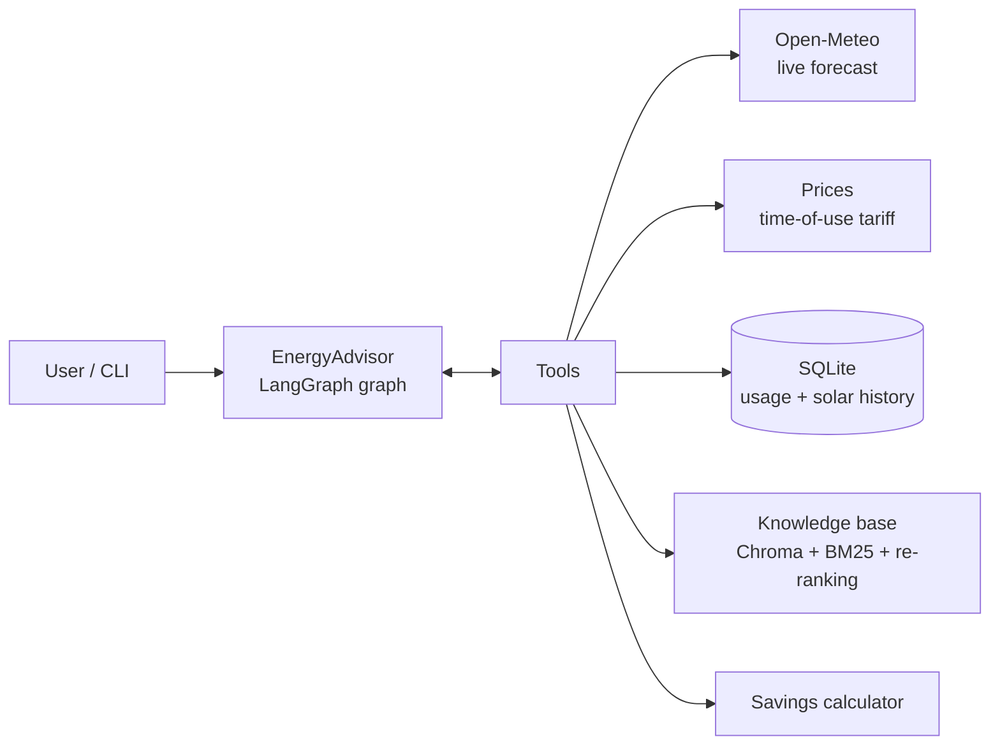

# Solar & EV Energy Optimizer Agent

An AI energy advisor built with **LangGraph**. It recommends when to charge an EV and when to run heating,
cooling, appliances and pool pumps, using live weather forecasts, time-of-use electricity prices, the
household's usage history and a RAG knowledge base of energy-saving tips. It calculates savings and CO₂ impact
with dedicated tools instead of guessing.

> Work in progress: this repository is being refactored from course notebooks into a production-style package
> (see [PLAN.md](PLAN.md)). Phases 0-2 are done: package, settings, CLI, tests and CI. The next phases move
> the household to Munich and replace the mock tariff with real German day-ahead prices.

## Quick start

Requires Python 3.12 and [uv](https://docs.astral.sh/uv/).

```bash
uv sync --all-extras              # create .venv and install locked dependencies
cp .env.example .env              # then add your OPENAI_API_KEY

uv run energy-advisor seed-db     # reproducible sample history (30 days, ending yesterday)
uv run energy-advisor build-index # embed the knowledge base into Chroma
uv run energy-advisor ask "When should I charge my electric car tomorrow to minimize cost and maximize solar power?"
```

## Commands

| Command | What it does |
|---|---|
| `energy-advisor seed-db [--days 30] [--seed 42]` | Creates `data/energy_data.db` with sample usage and solar data. Same seed, same data; re-running replaces the data. |
| `energy-advisor build-index [--rebuild]` | Loads `knowledge_base/*.txt`, splits it into chunks, embeds and stores it in `data/vectorstore/`. |
| `energy-advisor rag-benchmark [--k 3]` | Compares vector, hybrid and hybrid + re-ranking retrieval on 12 labelled queries (hit@k, MRR). |
| `energy-advisor ask "<question>"` | Answers one question and shows which tools the agent called. |
| `energy-advisor eval [--limit N] [--cases file.yaml]` | Runs the evaluation cases, scores them (LLM judge + tool usage) and writes a Markdown/JSON report and a heatmap to `reports/`. |
| `energy-advisor report` | Writes charts (usage profile, usage vs. solar, tomorrow's optimization window, projected savings) to `reports/charts/`. |

## How it works



- **Agent loop:** a LangGraph `StateGraph` with the routing `agent → tools → agent → … → answer`. Tool errors
  come back to the model as messages it can react to. A failure of the whole run returns an apology instead
  of raising, and a recursion limit stops endless loops. The current date and an 8-day calendar are injected,
  so "tomorrow" and "Wednesday" resolve to exact dates.
- **Seven tools:** weather forecast, electricity prices, usage history, solar history, recent summary,
  knowledge-base search and savings calculation. Database tools return aggregates (per device, per day,
  average by hour) instead of thousands of raw rows.
- **Advanced RAG:** hybrid retrieval (vector search + BM25 keyword search, merged with Reciprocal Rank
  Fusion), followed by LLM re-ranking. If re-ranking fails, results fall back to the fused order.
- **Live weather:** Open-Meteo (free, no key). If the API is unavailable, a deterministic simulated forecast is
  used and the output says so.

### Retrieval benchmark (`energy-advisor rag-benchmark`)

| Method | hit@3 | MRR |
|---|---|---|
| Vector search | 0.92 | 0.83 |
| Hybrid (vector + BM25, RRF) | 0.92 | 0.82 |
| Hybrid + LLM re-ranking | **1.00** | **0.90** |

Hybrid fusion alone does not help on such a small knowledge base; re-ranking does. With 12 queries this is
an indication, not a solid benchmark.

## Configuration

All settings live in one typed class, [`Settings`](src/energy_advisor/config.py) (pydantic-settings). Values
come from environment variables or `.env`. Nested values use a double underscore:

| Variable | Default | Meaning |
|---|---|---|
| `OPENAI_API_KEY` | – | Required for `ask`, `eval`, `build-index`, `rag-benchmark` |
| `OPENAI_BASE_URL` | OpenAI | Optional, for OpenAI-compatible proxies |
| `LLM__MODEL` / `LLM__JUDGE_MODEL` | `gpt-4o-mini` | Agent model / evaluation judge |
| `LOCATION__NAME`, `LOCATION__LATITUDE`, ... | Munich | Household location and time zone |
| `HOUSEHOLD__CO2_KG_PER_KWH` | `0.4` | Grid carbon intensity used for CO₂ estimates |
| `PATHS__DB`, `PATHS__VECTORSTORE`, ... | `data/...` | File locations |

## Project structure

```
src/energy_advisor/
├── config.py            # Settings: the single source of configuration
├── cli.py               # Typer CLI (replaces the former notebooks)
├── llm.py               # chat model / embeddings factories
├── agent/               # graph.py (LangGraph), tools.py, prompts.py, trace.py
├── clients/             # open_meteo.py (HTTP client)
├── services/            # weather, prices, savings, container (dependency injection)
├── data/                # SQLAlchemy 2.0 models, repository, aggregation, seed
├── rag/                 # ingest, retrieval (BM25 + RRF), rerank, knowledge_base, benchmark
├── evaluation/          # cases.yaml, judge (LLM-as-judge), metrics, runner, report
└── viz/                 # charts (matplotlib, optional "viz" extra)
knowledge_base/          # energy-saving documents used by RAG
tests/                   # unit tests (offline) + integration tests (marked)
```

## Tests and quality

```bash
uv run pytest                     # offline tests: no network, no API key, temporary databases
uv run pytest -m integration      # real Open-Meteo API
uv run pytest -m llm              # real LLM + embeddings (needs OPENAI_API_KEY, costs a little)
uv run pytest --cov               # with coverage
uv run ruff check . && uv run ruff format --check .
```

- The offline tests run HTTP calls against recorded responses (respx), the agent graph against a scripted fake
  LLM, and RAG against deterministic fake embeddings. They are fast and reproducible, and they need no secrets
  in CI.
- Regression tests carry IDs (F-02 … F-11) so that a fixed bug cannot silently come back, for example
  "a one-day query must not leak midnight rows of the next day" (F-07).
- GitHub Actions runs lint, format check and tests on every push and pull request. pre-commit hooks run ruff and
  a secret scanner before each commit (`uv run pre-commit install`).

## Known limitations

- Electricity prices are a mock time-of-use tariff, and the usage data is synthetic (both are being replaced; see
  [PLAN.md](PLAN.md)).
- The agent sometimes picks wrong dates or hours (for example "Monday" when today is Monday), and the LLM judge
  sometimes makes date errors too. A deterministic scheduling tool is planned.
- LLM-as-judge scores are indicative, not ground truth. The CO₂ factor and typical device consumption are stated
  assumptions.

## Origin

The scenario (the "EcoHome" smart-home energy advisor) and the starter skeleton come from a course project. This
repository extends it with hybrid RAG with re-ranking, live weather, the evaluation framework, regression tests
and the refactoring into a tested, configurable package.

## License

MIT, see [LICENSE](LICENSE).
