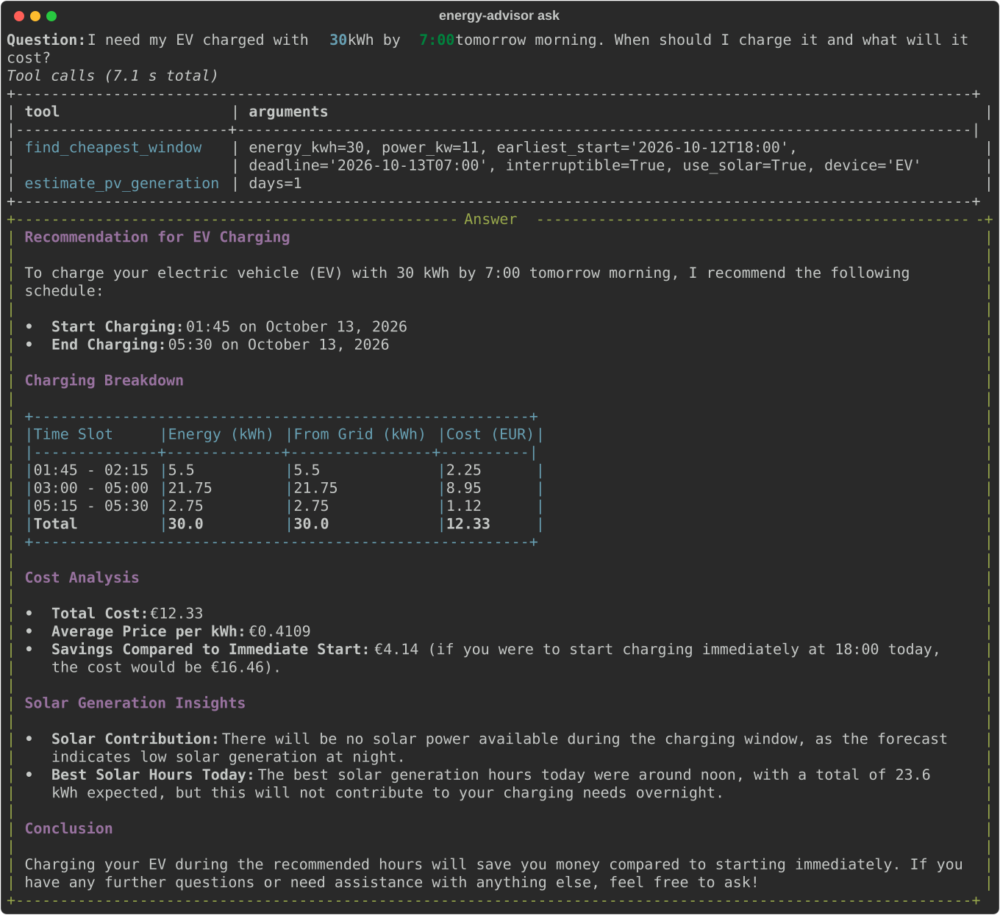
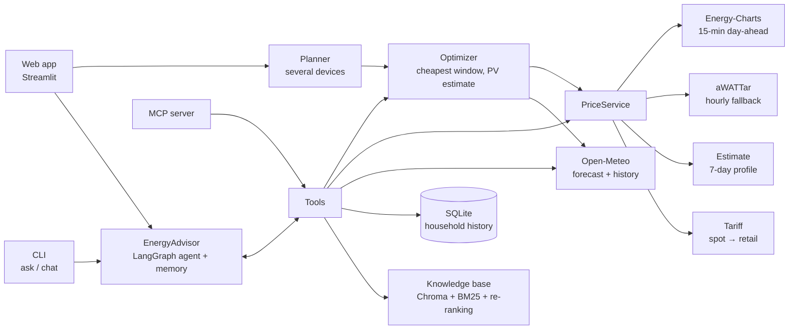
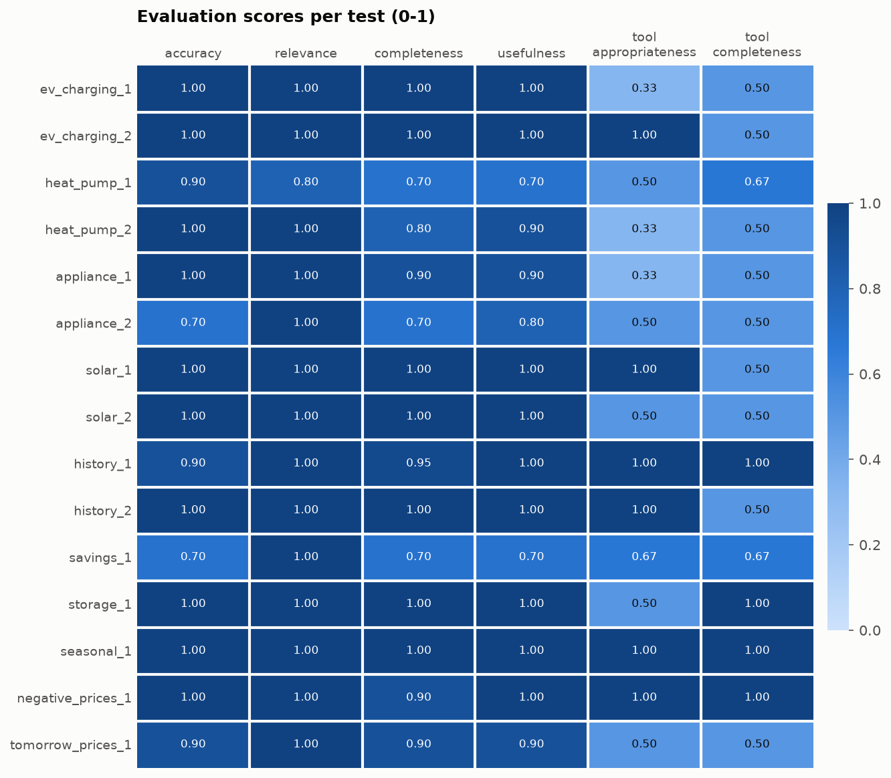
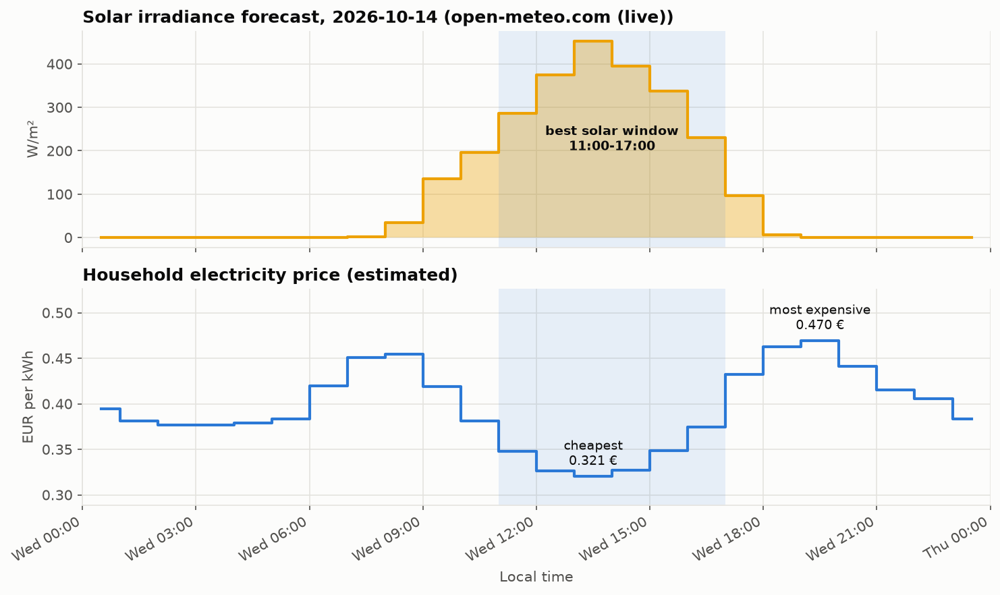
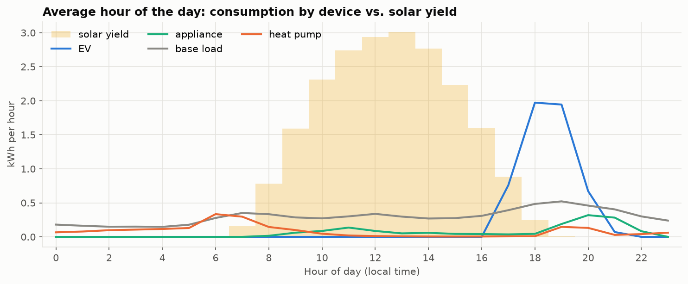

# Solar & EV Energy Optimizer Agent

[](https://github.com/tohver/solar-ev-energy-optimizer-agent-langgraph/actions/workflows/ci.yml)


An AI energy advisor for a household in **Munich** with a PV system, a heat pump, an electric car and a
**dynamic electricity tariff**. It answers questions like *"When should I charge my car before 7:00 tomorrow?"*
using **real German day-ahead prices**, a **live solar forecast**, the household's usage history and a RAG
knowledge base. Schedules come from a **deterministic optimizer**, not from LLM arithmetic.

Three ways to use it, one code path behind all of them:

- a **web app** (Streamlit): choose a time window and devices, press OK, get the best times with costs and
  savings, or chat with the advisor;
- a **CLI** with a LangGraph agent that remembers the conversation;
- an **MCP server**, so Claude Desktop, Claude Code or VS Code can use the advisor's tools.



## Documentation

| Document | What it covers |
|---|---|
| [guide.md](guide.md) | Tour of every feature, all assumptions to check, what each module does and why |
| [calculations.md](calculations.md) | Every formula in plain language, where each piece of data comes from and how long it is stored |
| [mcp.md](mcp.md) | How MCP and the MCP server work, and how to connect Claude Desktop, Claude Code or VS Code |
| [PLAN.md](PLAN.md) · [CHANGELOG.md](CHANGELOG.md) | Development plan with notes per phase · release history |

## What it does

- **Finds the best time to run devices**: the cheapest hours before a deadline for the EV, the dishwasher or
  the washing machine, combining hourly prices with the expected solar surplus. Several devices are planned
  together and share the solar surplus, so it is never counted twice.
- **Uses real market data**: day-ahead prices for the DE-LU bidding zone (Energy-Charts, aWATTar), converted to
  the price a household pays; estimates are clearly labelled when tomorrow's prices are not published yet.
- **Knows the weather**: live hourly forecast and PV yield estimate from Open-Meteo.
- **Analyses the household**: consumption per device, cost, solar self-consumption, export and grid import.
- **Quantifies**: savings in EUR and kWh, CO₂, and the saving compared with "just start now".
- **Remembers the conversation**: if you do not say by when, it plans for the next 24 hours, says so and asks;
  your answer is used in the next turn.
- **Cites sources**: tips from a knowledge base for German households (heat pumps, §14a EnWG, feed-in tariff,
  dynamic tariffs), retrieved with hybrid search and LLM re-ranking.

## Web app

```bash
uv run --extra app streamlit run app/streamlit_app.py      # http://localhost:8501
```

- **Sidebar (all settings):** *From* (default: now), *Deadline* (default: From + 24 h), the devices (electric
  car with the energy to charge, dishwasher, washing machine), **OK**, and *New conversation* at the bottom.
- **Best times:** after OK, a result panel per device: the time slots with energy from solar and from the grid
  and their cost, then the cost analysis (total, average price, cost of starting immediately, saving) and the
  solar contribution; below it, a chart of when each device runs, the price and the solar surplus.
- **Chat:** the agent with memory; example questions as buttons; scheduling questions use the sidebar window.
- **Prices & solar:** the two charts shown below under *Example charts*, for the sidebar window.

The app uses the dark palette and monospace font of the terminal screen above (`.streamlit/config.toml`).

## Architecture



The agent is a LangGraph `StateGraph`: the model decides which tool to call, the tool result goes back to the
model, and the loop ends with an answer. A checkpointer stores each conversation per thread. Business logic
(prices, scheduling, aggregation, retrieval) lives in plain, tested Python modules; the agent's tools, the app
and the MCP server are thin layers on top. All services are built from one typed `Settings` object and
injected, so tests replace the network, the clock and the LLM with fakes.

## Highlights

| | |
|---|---|
| **Deterministic optimizer** | Evaluates every start time (appliances, which run in one go) or fills the cheapest capacity (EV, which can pause and modulate). Own solar power is valued at the feed-in tariff, its opportunity cost. Several devices share the solar surplus. |
| **Real prices, honest fallbacks** | Energy-Charts → aWATTar → 7-day estimate → synthetic profile. Every result carries `source` and `is_estimate`; published prices are cached on disk (the APIs rate-limit). |
| **Time zones done right** | Aware datetimes only (enforced by ruff `DTZ`), UTC storage, DST days with 23 and 25 hours are tested; Open-Meteo is queried in UTC because local hours are ambiguous on DST days. |
| **Realistic household history** | Generated from real past weather and real past prices: PV from irradiance, heat pump with temperature-dependent COP, EV sessions, appliance cycles. |
| **Hybrid RAG** | Vector search + BM25, fused with Reciprocal Rank Fusion, then LLM re-ranking with a fallback. Benchmarked with hit@k and MRR. |
| **Evaluation framework** | 15 YAML test cases, LLM-as-judge plus deterministic tool-usage metrics, Markdown/JSON reports, a heatmap, and an ablation mode. |
| **Three front ends, one code path** | Web app, CLI agent with memory, MCP server. A fix in the optimizer or the price service reaches all of them. |
| **Engineering** | src layout, pydantic-settings, SQLAlchemy 2.0, 209 offline tests (96% coverage) incl. the web app (Streamlit `AppTest`) and the MCP server over stdio, ruff, mypy strict, pre-commit with secret scanning, GitHub Actions. |

## Quick start

Requires Python 3.12 and [uv](https://docs.astral.sh/uv/).

```bash
uv sync --all-extras              # create .venv and install locked dependencies (incl. app and MCP extras)
cp .env.example .env              # then add your OPENAI_API_KEY

uv run energy-advisor seed-db     # 30 days of household history from real weather and prices
uv run energy-advisor build-index # embed the knowledge base into Chroma

uv run --extra app streamlit run app/streamlit_app.py   # web app
uv run energy-advisor chat        # or: a conversation in the terminal
```

Prices, weather, the solar forecast and the optimizer work without an API key (web app *Best times* and
*Prices & solar*, MCP scheduling tools). The chat, `ask`, `eval` and the knowledge base need `OPENAI_API_KEY`.

## Commands

| Command | What it does |
|---|---|
| `energy-advisor seed-db [--days 30] [--seed 42]` | Household history (max. 90 days) from past Open-Meteo weather and past day-ahead prices; re-running replaces it. |
| `energy-advisor build-index [--rebuild]` | Splits and embeds `knowledge_base/*.txt` into `data/vectorstore/`. |
| `energy-advisor ask "<question>" [--export-svg file.svg]` | One answer plus the tool calls the agent made. |
| `energy-advisor chat` | A conversation: the agent remembers earlier messages (e.g. asks by when, then uses your answer). |
| `uv run --extra app streamlit run app/streamlit_app.py` | The web app (see above). |
| `energy-advisor mcp [--transport http]` | MCP server with the advisor's tools for Claude Desktop, Claude Code, VS Code. See [mcp.md](mcp.md). |
| `energy-advisor eval [--limit N] [--cases file.yaml] [--no-optimizer]` | Runs the evaluation cases; writes Markdown, JSON and a heatmap to `reports/`. `--no-optimizer` is the ablation run. |
| `energy-advisor rag-benchmark [--k 3]` | hit@k and MRR for vector, hybrid and hybrid + re-ranking retrieval on 12 labelled queries. |
| `energy-advisor report` | Charts: usage profile vs. solar, daily usage vs. solar, tomorrow's price/solar window, savings. |

## Evaluation

15 test questions (EV charging, heat pump, appliances, solar, history, savings, battery, negative prices,
unpublished prices) are answered by the agent (`gpt-4o-mini`) and scored by a stronger LLM judge (`gpt-4.1`) that
sees the tool outputs and the same calendar as the agent, plus deterministic tool-usage metrics.

**Does the deterministic optimizer help?** Ablation on 2026-10-12: the same agent, prompt, data and judge, once
with and once without the optimizer tools (`energy-advisor eval --no-optimizer`):

| Metric (0-1) | Without optimizer | With optimizer |
|---|---|---|
| Accuracy, all 15 questions | 0.81 | **0.94** |
| Accuracy, 5 scheduling questions | 0.72 | **0.94** |
| Overall response score, scheduling questions | 0.79 | **0.95** |
| Overall response score, other questions | 0.91 | 0.93 |

Typical failures without the tool: a dishwasher saving computed with the wrong evening price and an unrealistic
energy per cycle (accuracy 0.30 → 1.00 with the tool), and an EV schedule with a misread weekday. With the tool
the schedule, its cost and the saving come from tested code, and the answer only has to report them.



Full report: [docs/evaluation-report.md](docs/evaluation-report.md). Weakest point: **tool completeness (0.66)**:
the agent often skips the mandatory knowledge-base search. These are single runs with a non-deterministic LLM
(scores vary by about ±0.1). The numbers were measured before the later changes to deadline handling and
conversation memory; `energy-advisor eval` reproduces them with the current version.

## Example charts

Both charts are generated by `energy-advisor report` and shown live in the web app's *Prices & solar* view.





## Configuration

All settings live in one typed class, [`Settings`](src/energy_advisor/config.py). Values come from environment
variables or `.env`; nested values use a double underscore. Moving the household to another German city means
changing the `LOCATION__*` values.

| Variable | Default | Meaning |
|---|---|---|
| `OPENAI_API_KEY` | – | Required for the chat, `ask`, `eval`, `build-index`, `rag-benchmark` |
| `OPENAI_BASE_URL` | OpenAI | Optional, for OpenAI-compatible endpoints |
| `LLM__MODEL` / `LLM__JUDGE_MODEL` | `gpt-4o-mini` / `gpt-4.1` | Agent model / evaluation judge |
| `LOCATION__NAME`, `__LATITUDE`, `__LONGITUDE`, `__TIMEZONE` | Munich, Europe/Berlin | Household location |
| `TARIFF__SURCHARGES_EUR_PER_KWH` | `0.19` | Grid fees, levies, taxes and supplier margin (net) added to the spot price |
| `TARIFF__VAT_RATE` / `TARIFF__FEED_IN_TARIFF_EUR_PER_KWH` | `0.19` / `0.078` | VAT; payment for exported solar power |
| `PRICES__PROVIDERS` | `["energy_charts","awattar"]` | Real price sources, in order |
| `HOUSEHOLD__PV_PEAK_KW`, `__WALLBOX_KW`, ... | 8 kWp, 11 kW | The demo household |

## Project structure

```
src/energy_advisor/
├── config.py · timeutils.py · llm.py · cli.py · mcp_server.py
├── agent/          # LangGraph graph with memory, 9 tools, system prompt, result helpers
├── optimization/   # scheduler (pure functions) + service (window, single device, several devices)
├── services/       # weather, prices (provider chain), tariff, savings, dependency-injection container
├── clients/        # Open-Meteo; prices/: Energy-Charts, aWATTar, cache, estimate, synthetic
├── domain/         # weather, prices, sun position and PV yield, climate, household profile
├── data/           # SQLAlchemy models (UTC), repository, aggregation, household history generator
├── rag/            # ingest, BM25 + RRF, LLM re-ranking, knowledge base, benchmark
├── evaluation/     # cases.yaml, LLM judge, tool metrics, runner, report
├── ui/             # web app helpers: time window, result screen, Altair charts
└── viz/            # matplotlib charts (README images, Prices & solar view)
app/streamlit_app.py  # the web app
knowledge_base/       # 8 documents for German households
tests/                # unit (offline) and integration (marked) tests; fixtures are recorded API responses
.streamlit/           # web app theme
```

## Tests and quality

```bash
uv run pytest                     # offline: no network, no API key, temporary databases, fixed clock
uv run pytest -m integration      # real Open-Meteo, Energy-Charts and aWATTar APIs
uv run pytest -m llm              # real LLM + embeddings (needs OPENAI_API_KEY)
uv run pytest --cov               # coverage
uv run ruff check . && uv run ruff format --check . && uv run mypy
```

- HTTP calls run against recorded real responses (respx); the agent graph runs against a scripted fake LLM;
  RAG uses deterministic fake embeddings. The web app is rendered headless with Streamlit's `AppTest`, and the
  MCP server is tested through a real MCP client, in memory and as a separate process over stdio.
- Regression tests carry IDs (F-02 … F-11), so fixed bugs cannot silently come back.
- GitHub Actions runs the lock check, lint, format check, type check and tests (coverage ≥ 85 %) on every push
  and pull request.

## Limitations and assumptions

- The household is synthetic (driven by real weather and prices). Grid surcharges, the feed-in tariff, the CO₂
  factor (0.36 kg/kWh) and device powers are stated, configurable assumptions; see [guide.md](guide.md),
  section 3.
- PV yield uses horizontal irradiance and a fixed performance ratio (no tilt/orientation model).
- Estimated prices (before ~13:00 for tomorrow, or beyond) are averages of recent days, not forecasts.
- With almost flat prices, the EV schedule can be split into several short blocks that save only cents compared
  with one continuous block.
- Separate chat questions are planned independently, so two devices asked about one after the other can count
  the same solar surplus; the web app's planner plans them together and avoids this.
- Conversations are kept in memory only (until the CLI or the web server stops). The web app and the MCP HTTP
  mode have no authentication and are meant for local use.
- The agent can still misread ambiguous dates, e.g. "by 7:00 on Monday" asked on a Monday evening.
- `gpt-4o-mini` does not always follow the prompt's tool rules (see tool completeness above). LLM-as-judge
  scores are indicative; the judge itself sometimes misreads dates.

## Data sources and licences

- Day-ahead prices: [Energy-Charts](https://energy-charts.info) (Fraunhofer ISE), data Bundesnetzagentur |
  SMARD.de, **CC BY 4.0**; [aWATTar](https://www.awattar.de) market data API.
- Weather and geocoding: [Open-Meteo](https://open-meteo.com), **CC BY 4.0**.

## Origin

The project started as a course exercise (a "smart-home energy advisor" scenario with a notebook skeleton, two
tip documents and a mock tariff). This repository is my rework of it into a tested package: real German market
and weather data, the Munich household model, the deterministic optimizer and planner, time-zone handling,
hybrid RAG with re-ranking, the evaluation framework, conversation memory, the web app, the MCP server and the
engineering setup. The development plan is in [PLAN.md](PLAN.md).

## License

MIT, see [LICENSE](LICENSE).
